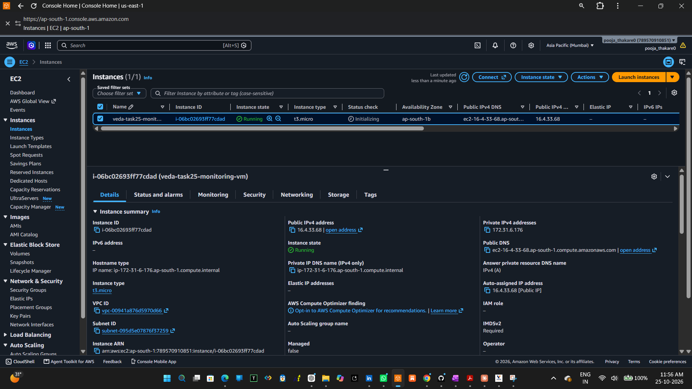
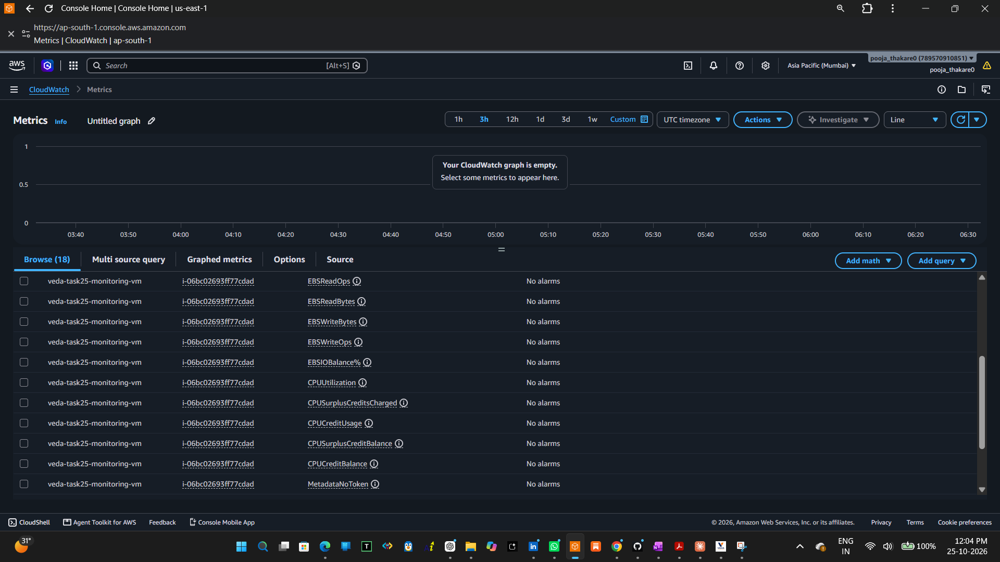
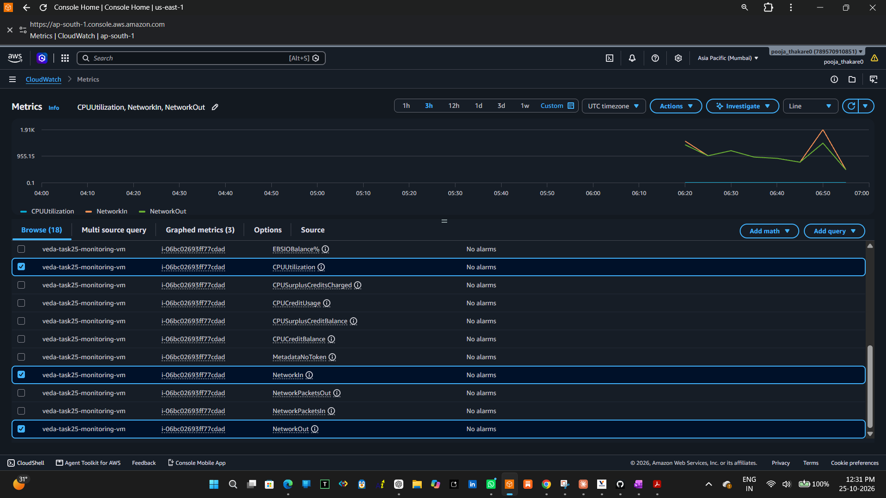
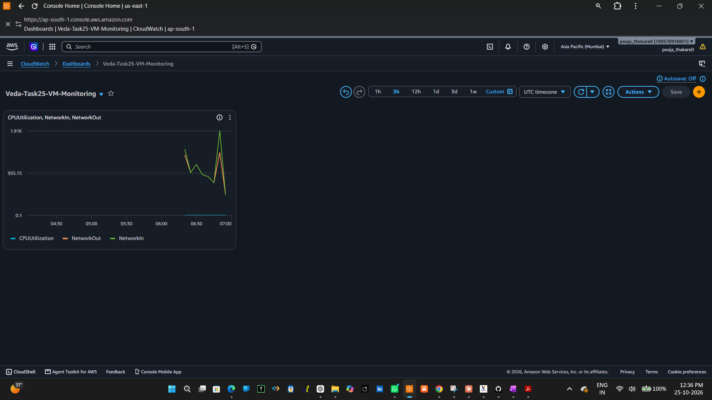

# Task 25: Monitor VM CPU and Network Usage

## Overview
This project demonstrates virtual machine monitoring using Amazon Web Services (AWS) CloudWatch. An Ubuntu Linux virtual machine hosted on Amazon EC2 is monitored to observe CPU utilization and network traffic.

This task was completed as part of the **Veda Technology Cloud Computing Internship**.

## Objectives
- Monitor EC2 instance CPU utilization.
- Observe incoming and outgoing network traffic.
- Create a custom Amazon CloudWatch dashboard.
- Visualize and document cloud infrastructure metrics.

## Tools and Technologies
- **Amazon EC2:** Cloud virtual machine hosting.
- **Amazon CloudWatch:** Monitoring and metrics visualization.
- **Ubuntu Linux:** Operating system running on the EC2 instance.
- **AWS Management Console:** Resource configuration and management.

## EC2 Instance Configuration

| Configuration | Details |
|---|---|
| Instance Name | `veda-task25-monitoring-vm` |
| Instance Type | `t3.micro` |
| Operating System | Ubuntu Linux |
| AWS Region | Asia Pacific (Mumbai) — `ap-south-1` |
| Monitoring Service | Amazon CloudWatch |

## CloudWatch Metrics

Three metrics were selected for monitoring:

### 1. CPUUtilization
Measures the percentage of allocated EC2 CPU capacity in use.

### 2. NetworkIn
Measures the amount of network data received by the EC2 instance.

### 3. NetworkOut
Measures the amount of network data sent by the EC2 instance.

## CloudWatch Dashboard

A custom dashboard named `Veda-Task25-VM-Monitoring` was created to display CPU utilization and network traffic metrics.

The dashboard provides a centralized view of the selected EC2 performance metrics.

## Implementation Steps

1. Created and verified an Amazon EC2 virtual machine.
2. Opened Amazon CloudWatch in the AWS Management Console.
3. Selected the EC2 CPU utilization metric.
4. Added NetworkIn and NetworkOut metrics.
5. Created the custom CloudWatch dashboard.
6. Captured screenshots documenting the instance and monitoring configuration.

## Screenshots and Evidence

### 1. EC2 Instance Running

### 2. CloudWatch CPU Metric

### 3. CloudWatch Network Metrics

### 4. CloudWatch Monitoring Dashboard

## Result

A custom Amazon CloudWatch dashboard was created with CPUUtilization, NetworkIn, and NetworkOut metrics for the EC2 virtual machine.

## Conclusion

This task provided practical experience in cloud virtual machine monitoring using Amazon CloudWatch. It demonstrated how CPU utilization and network traffic metrics can be selected and visualized to support cloud infrastructure monitoring.

